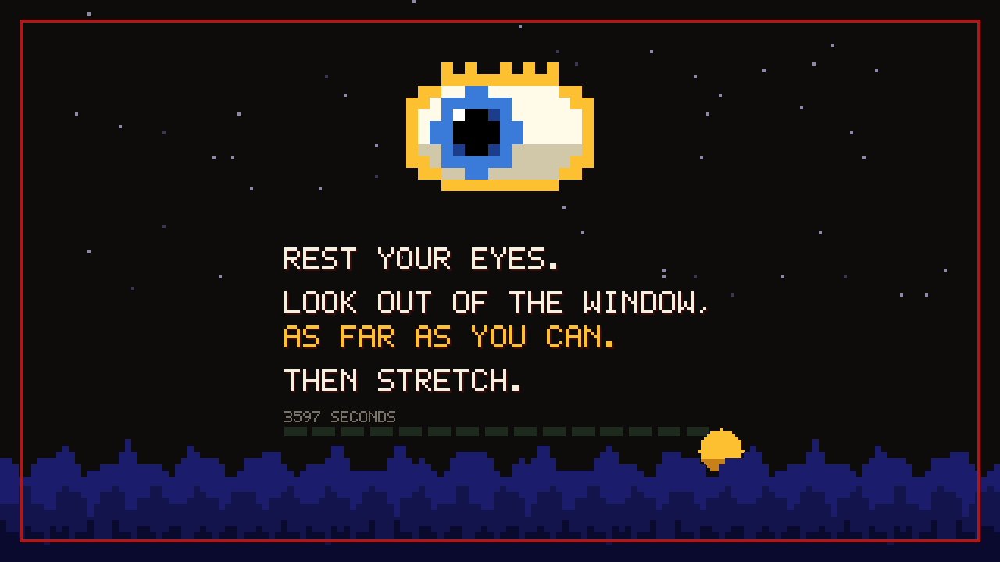
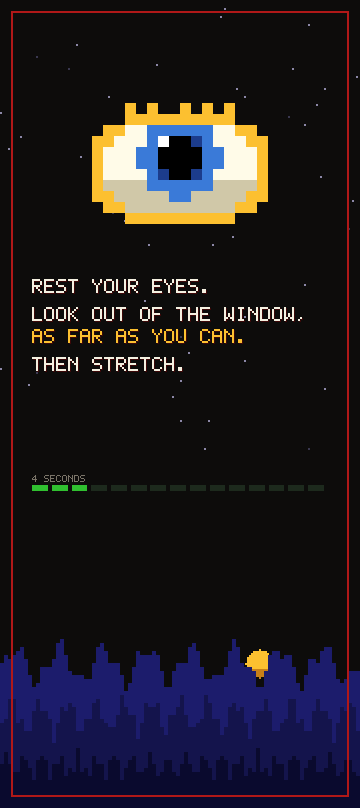
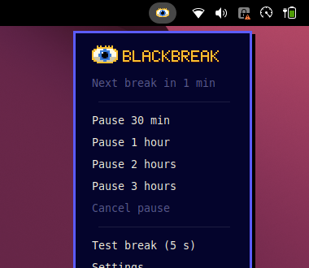
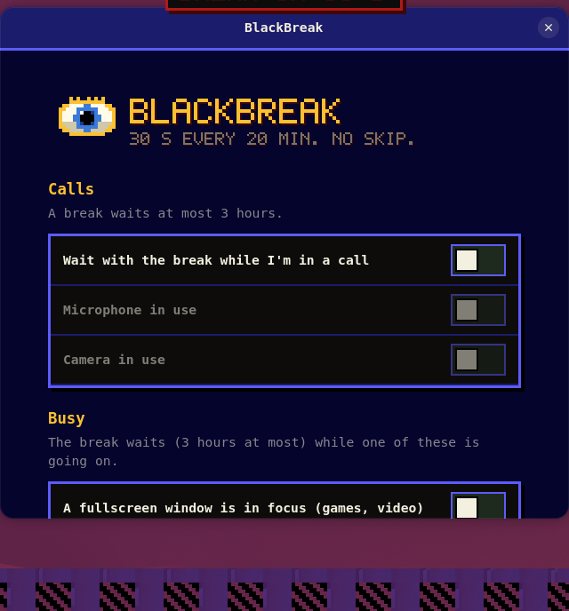
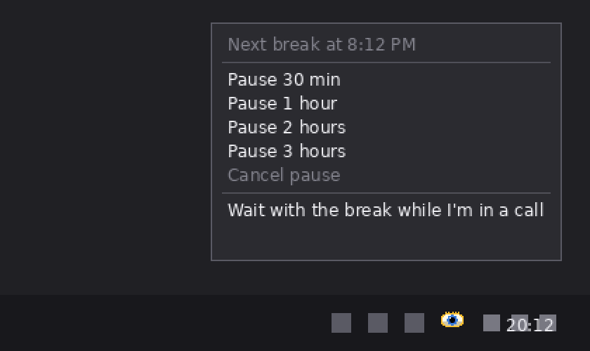
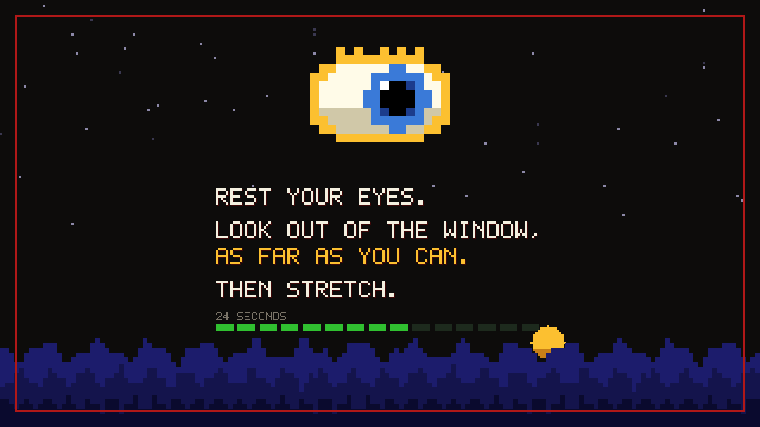
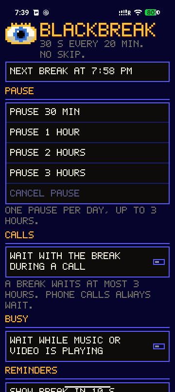

# BlackBreak

**20-30-20:** every 20 minutes the screen is covered for 30 seconds, so you look at something about
20 feet (6 m) away. There is no skip button: you decide in advance (pause, or wait during a call), never in the moment.

During the break you see three plain lines, the seconds left and a progress bar, in English or Slovak by your
system language:

    Rest your eyes.
    Look out of the window, as far as you can.
    Then stretch.

Ten seconds before a break a small box says `Break in 10 s`. Five idle minutes count as rest and the
20 minutes start again. After a restart a fresh interval begins. The look is old-school pixel art.

| Platform | Status | Where it lives |
|---|---|---|
| Linux (GNOME 50, Wayland) | available | top bar eye icon, menu and settings |
| Windows 10 and 11 | available | tray icon and menu |
| Android 8 or newer | available | one app screen |
| iOS | later | needs a paid Apple developer account and Apple's approval of the Screen Time entitlement |

## Linux

The eye icon in the top bar opens the menu; `Settings` holds the options.

Download `blackbreak-linux-gnome-vX.Y.Z.zip` from the latest release, then:

    gnome-extensions install blackbreak-linux-gnome-vX.Y.Z.zip

Log out and back in, then `gnome-extensions enable blackbreak@junkers4.github.io`.
From a checkout, `make -C linux install` does the same.

## Windows

The eye sits in the notification area (bottom right, next to the clock); right- or left-click opens the menu.
The break covers every monitor, the primary one shows the pixel scene.

*These two pictures are renderings made from the app's drawing code; the pixel look has not been run on a real
Windows PC yet.*

Download `blackbreak-windows-x64-vX.Y.Z.zip`, unzip it anywhere and run `BlackBreak.exe` once. It starts with
Windows from then on. SmartScreen will warn because the exe is unsigned: choose "More info", then "Run anyway".
Two copies of the exe keep each other alive, and a break that was running continues for what was left of it.
`Quit` is not in the menu on purpose.

## Android

The app has one screen: the next break, pause buttons and the options. Download `blackbreak-android-vX.Y.Z.apk`,
open the app and tap `Allow BlackBreak to show over other apps`. That is the only permission needed (plus
notifications, for the quiet "BlackBreak is on" entry). No accessibility service. The break is a window drawn over
other apps; it starts again after a restart. A phone call always waits.

## Pause and options

- **Pause:** 30 minutes, 1, 2 or 3 hours, once per day (local time). Cancelling early still uses it. Only in a normal work interval.
- **Calls:** a break waits (3 hours at most) while a call is going on: microphone or camera on Linux and Windows, any call on Android.
- **Linux and Android extras, all off by default:** wait while a fullscreen window or a chosen app is in focus (Linux); wait while music or video plays, apps a break never covers while they are on screen (navigation such as Waze or Maps; needs Usage access), a short buzz at the end (Android). Both can hide the 10 s warning, offer a 5 s `Test break`, and show the breaks taken today.

## What it cannot block

Windows: the Ctrl+Alt+Del screen, Win+L, signing out and the power button. Android: the power button, Emergency SOS,
a forced reboot and the system gestures (the break stays on top of them). Linux: switching to a text console and
rebooting. If anything goes wrong, the break screen removes itself after 35 seconds.

## Releases

Builds are on the GitHub Releases page with a `SHA256SUMS` file (`sha256sum -c --ignore-missing SHA256SUMS`).
Versions follow SemVer; release notes come from `CHANGELOG.md`.

## Development

    make -C linux test-all        # scheduler, detector and headless GNOME tests
    android/build.sh debug        # APK from smali + Java, no Gradle
    dotnet test windows/Core.Tests

The timing rules are written once in assembler (`core/`) and pinned by `spec/`; requirements and their tests are in
`docs/requirements.md`.

## License

MIT
