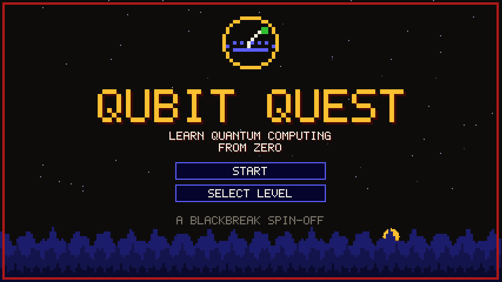
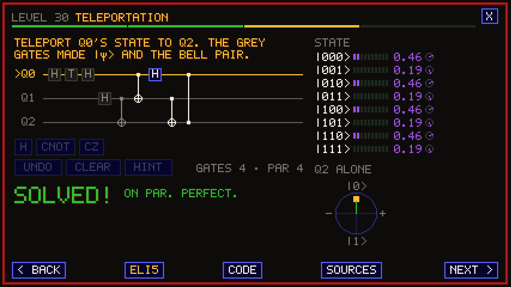
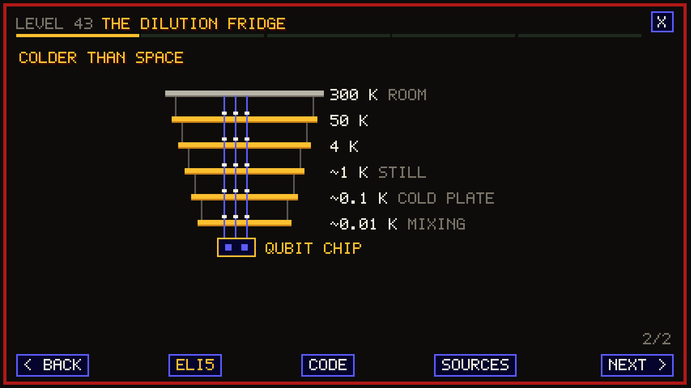
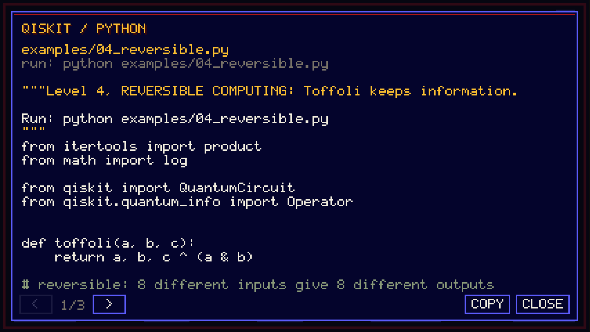

# Qubit Quest

Learn quantum computing from zero, level by level, in the old-school pixel look of
[BlackBreak](https://github.com/junkers4/blackbreak): red pixel frame, segmented bars,
a gold and white 5x7 pixel font, Doom-blue menus, no smoothing.






60 levels in 8 worlds, all in English, from bits to real hardware:

| World | Levels |
|---|---|
| 1. Classical warm-up | bits, binary numbers, logic gates, reversible computing |
| 2. Math toolkit | probability, vectors, matrices, complex numbers, phase and Euler, inner products, tensor products, unitary matrices |
| 3. One qubit | the qubit, measurement, X, superposition (H), interference, phase (Z S T), the Bloch sphere, bases and rotations |
| 4. Many qubits | two qubits, CNOT, entanglement, the four Bell states, SWAP, no cloning, Toffoli and universality, the Bell (CHSH) test |
| 5. Quantum protocols | superdense coding, teleportation, BB84 key distribution |
| 6. Algorithms | phase kickback, Deutsch, Deutsch-Jozsa, Bernstein-Vazirani, Simon, Grover, the quantum Fourier transform, phase estimation, Shor |
| 7. Quantum hardware | DiVincenzo's checklist, superconducting qubits, the qubit chip (silicon or sapphire, Al/AlOx/Al junctions, tantalum), the dilution refrigerator part by part (vacuum can, shields, pulse tube, gold-plated copper plates), helium dilution (6.6% helium-3, still, sintered-silver heat exchangers), wires, filters and shields (stainless and NbTi coax, attenuators, circulators, TWPA, HEMT, infrared), control and readout (DRAG pulses, dispersive readout), trapped ions (Yb-171 at 369.5 nm, Paul traps, Mølmer-Sørensen gates, QCCD), optics and photons (Mach-Zehnder, down-conversion, nanowire detectors, photonic chips), neutral atoms (MOT, tweezers, AOD rearrangement, Rydberg gates), spins in silicon (silicon-28, spin-to-charge readout) |
| 8. Real quantum computers | noise, error correction, variational algorithms, Qiskit in practice, what next |

Every level has lessons, quizzes and circuit puzzles (1 to 3 qubits, black-box oracles, fixed
gates, partial goals), and on every step four buttons:

- **ELI5**: the idea explained like you are five.
- **CODE**: a runnable Python / Qiskit (or NumPy) example for the level, with a COPY button.
- **MORE**: the details behind the level: derivations, exact formulas, numbers, what things
  are made of and why.
- **SOURCES**: the papers and books behind it. Every source was checked against a
  bibliographic record; see [docs/REFERENCES.md](docs/REFERENCES.md).

The title screen also has a GATE BOOK (every gate, its matrix and Qiskit call), a GLOSSARY
and the full source list. In puzzles the state shows a probability bar, the size and a phase
dial per amplitude; tap it for the exact complex numbers.

## Play

One static page, no build, no dependencies: open `index.html` in a browser (desktop or
phone), or `make serve` and go to http://localhost:8000. Progress is kept in the browser.
`index.html?all` unlocks every level.

Keys: Enter / arrows to move on, 1-4 to answer, gate letters (H X Y Z S T, C = CNOT, V = CZ,
K = Toffoli...) to place gates, 0-2 or up/down to pick a wire, Backspace to undo, ? for a hint,
E for ELI5, P for code, R for sources, Esc for the level map.

## Run the examples

```bash
python -m pip install -r requirements.txt
```

```bash
python examples/30_teleport.py
```

## Checks

```bash
make test-all
```

- `make test`: simulator, curriculum, sources, generated files and the requirement table
  ([docs/requirements.md](docs/requirements.md): every requirement has a test).
- `make test-python`: every example runs and checks itself; the game's simulator gives exactly
  Qiskit's amplitudes for every puzzle solution and for random circuits.
- `make shots`: every level played in headless Chromium at four screen sizes; screenshots in `/tmp/qq`.
- `make check-refs`: every DOI, arXiv id and URL resolved online.

## Files

- `src/font.js` pixel font (upper and lower case, Greek, Slovak accents), palette, icon
- `src/sim.js` state-vector simulator (up to 3 qubits here), shortest-solution search
- `src/levels/*.js` the worlds and levels ([template](docs/LEVEL_TEMPLATE.md))
- `src/refs.js` the sources; `src/book.js` gate book and glossary; `src/pics.js` hardware drawings
- `src/examples.js` generated from `examples/*.py`; `src/game.js` screens, layout, input
- `tools/` generators and the online source check; `test/` node and browser tests; `tests/` pytest
